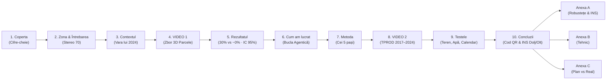
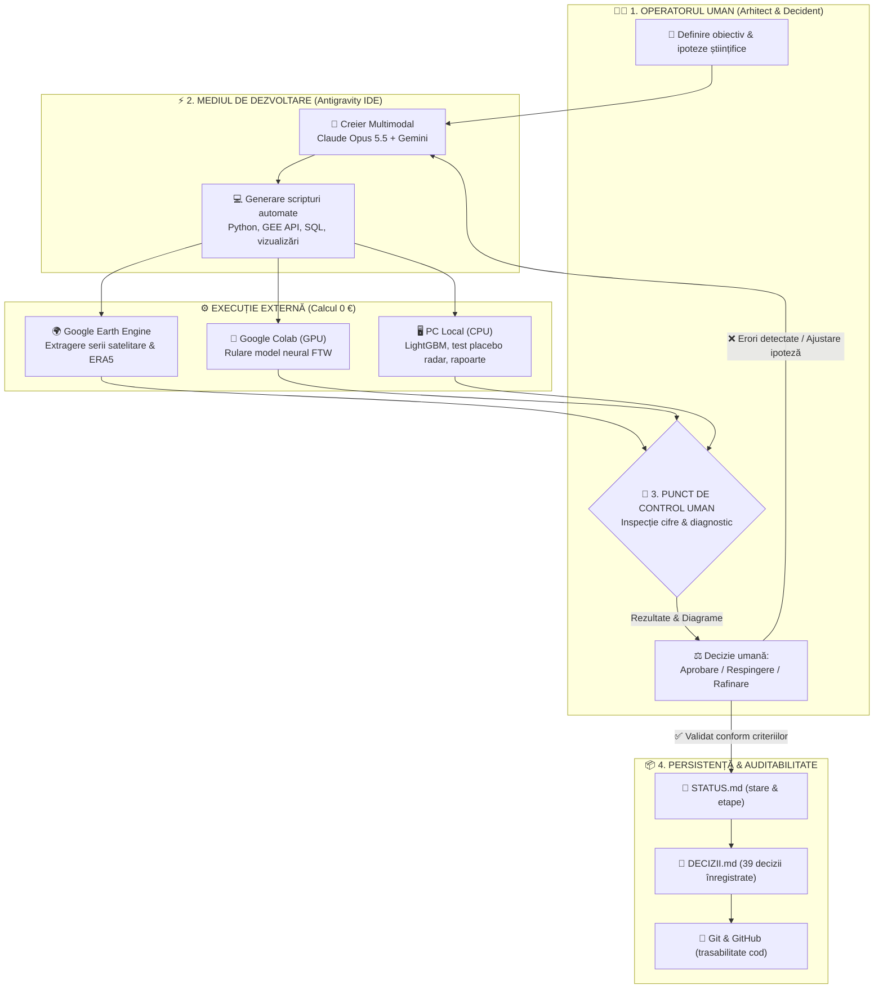

# 🛰️ Atlasul Secetei din 2024 — Sudul Olteniei
### Analiză parcelă cu parcelă prin teledetecție Copernicus, inteligență artificială agentică și validare statistică riguroasă

> **GIS Day 2026** · Universitatea de Științe Agronomice și Medicină Veterinară din București (USAMV)  
> Facultatea de Îmbunătățiri Funciare și Ingineria Mediului (FIFIM) · Amfiteatrul II 1 · 18 Noiembrie 2026  
> **Autor:** Patrick Andrei Lefter · AgroCliN · Uniunea Geodezilor din România (UGR) Comisia 3  

---

## 🌟 Livrabil Principal: Prezentarea Oficială

> [!IMPORTANT]  
> ### 📦 [DESCARCĂ PREZENTAREA COMPLETĂ (.ZIP — recomandat pentru telefon și PC)](https://github.com/lefterpatrickandrei-sketch/atlas-seceta-2024/raw/main/ppt/Atlasul_secetei_2024_v4_animatii.zip)
> **Arhivă:** `Atlasul_secetei_2024_v4_animatii.zip` → conține `Atlasul secetei din 2024 — v4 (animatii).pptx` *(25,7 MB, 13 slide-uri)*  
> ✨ **Include:** Ambele clipuri video încorporate nativ (zbor 3D 50s + evoluție multianuală 20s), tranziții inteligente (**Morph** & **Fade** prin negru), animații sincronizate de apariție, file interactive de navigare pe marginea din dreapta, **IC 95% (27–34%)**, date INS Dolj/Olt, Anexa A cu testele de robustețe, planșa Stereo 70 și notițele complete ale vorbitorului (*speaker notes*).  
> 💡 *Formatul `.zip` protejează animațiile și tranzițiile Morph împotriva previzualizărilor de pe telefon care le pot elimina la descărcarea directă.*
> 
> 🔗 [Deschide `.zip` în GitHub](https://github.com/lefterpatrickandrei-sketch/atlas-seceta-2024/blob/main/ppt/Atlasul_secetei_2024_v4_animatii.zip) · [Descarcă direct `.pptx`](https://github.com/lefterpatrickandrei-sketch/atlas-seceta-2024/raw/main/ppt/Atlasul%20secetei%20din%202024%20%E2%80%94%20v4%20(animatii).pptx)

### 🔗 Linkuri Rapide & Resurse Digitale
* 🌍 **Hartă Web Interactivă (Live):** [https://lefterpatrickandrei-sketch.github.io/atlas-seceta-2024/](https://lefterpatrickandrei-sketch.github.io/atlas-seceta-2024/)
* 📋 **Audit de Adevăr & Verificare Cifre:** [`ppt/_audit/audit.md`](ppt/_audit/audit.md)
* 📜 **Transcriere Completă Conversație & Q&A Gemini:** [`docs/conversatie_gemini/evaluare_prezentare_gis_day.md`](docs/conversatie_gemini/evaluare_prezentare_gis_day.md)
* ⚙️ **Registru de Decizii Tehnice (39 decizii validate):** [`DECIZII.md`](DECIZII.md)

---

## 📌 Cuprins
1. [Rezumat Executiv & Cifre-Cheie](#-rezumat-executiv--cifre-cheie)
2. [Ghidul Prezentării (13 Slide-uri)](#-ghidul-prezentării-13-slide-uri)
3. [Metodologia Științifică în 5 Pași](#-metodologia-științifică-în-5-pași)
4. [Cele Trei Ipoteze Testate](#-cele-trei-ipoteze-testate)
5. [Arhitectura Bucla Agentică (Omul în Buclă)](#-arhitectura-bucla-agentică-omul-în-buclă)
6. [Discurs Calibrat pentru Sală (Speech Track)](#-discurs-calibrat-pentru-sală-speech-track)
7. [Ghid Q&A: Întrebări Probabile din Sală](#-ghid-qa-întrebări-probabile-din-sală)
8. [Glosar Tehnic & Abrevieri](#-glosar-tehnic--abrevieri)
9. [Structura Proiectului & Date](#-structura-proiectului--date)

---

## 📊 Rezumat Executiv & Cifre-Cheie

Studiul analizează impactul secetei pedologice și atmosferice din vara anului 2024 pe o suprafață de **1.690 km²** în sudul Olteniei (sectorul Sadova – Bechet – Dăbuleni – Corabia, până la Dunăre), decupată în coordonate naționale **EPSG:3844 (Stereo 70)**.

| Metrică | Valoare Verificată | Sursă / Metodă |
|---|---|---|
| **Arie studiată** | **1.690 km²** (169.000 ha) | Contur AOI decupat pe frontiera de stat a României |
| **Parcele totale extrase** | **17.466 parcele** ($\ge 0,5\text{ ha}$, $826,5\text{ km}^2$) | Rețeaua neurală *Fields of The World* (10 m, Sentinel-2) |
| **Parcele arabile** | **13.237 parcele** | Filtrare mască JRC EUCROPMAP 2022 |
| **Parcele cu istoric valid** | **11.048 parcele** | Minim 2 ani comparabili cu aceeași grupă de cultură |
| **Pierdere culturi primăvară** | **−30,1% mediană** *(interval 24%–30%)* | Porumb, floarea-soarelui, soia ($4.973\text{ parcele}$, $18.154\text{ ha}$) |
| **Pierdere culturi toamnă** | **−0,2% mediană** *(interval 0%–18%)* | Grâu, orz, rapiță ($6.075\text{ parcele}$, $39.004\text{ ha}$) |
| **Anomalie climatică 2024** | **72% ploaie normală**, **+2,5 °C Tmax** | ERA5-Land (266 mm vs 370 mm); 23 zile caniculă $\ge 35\text{ }^\circ\text{C}$ |
| **Model teren (LightGBM)** | **$R^2 = 0,003$ (prim.) / $0,006$ (toamnă)** | 11 factori sol/relief/canale, CV spațial 5 km (82 blocuri) |
| **Detecție irigații (S1 Radar)** | **Placebo picat: 3,91% miriști vs 3,40%** | Regula radar nu separă udarea; **strat retras / nelivrabil** |
| **Validare externă INS** | **Porumb: −29,0% … −31,5%** | Date provizorii INS martie 2025 confirmă tiparul satelitar |

---

## 🖥️ Ghidul Prezentării (13 Slide-uri)

Prezentarea este concepută după principiul alternanței vizuale: **ecrane de impact cinematografic (dark mode)** urmate de **planșe analitice luminoase (cream)** unde datele rămân lizibile pentru audiență.



| Slide | Titlu Planșă | Fundal | Element Cheie / Dinamică | Timp Recomandat |
|:---:|---|:---:|---|:---:|
| **1** | **Coperta: Atlasul secetei din 2024** | Crem | Apariție succesivă cifre (17.466, 30%, ≈0) + lupă detaliu | 0:00 – 0:20 |
| **2** | **Planșa 2 · Zona și Întrebarea** | Crem | Tranziție **Morph** lupă localizare Sadova–Corabia (Stereo 70) | 0:20 – 1:05 |
| **3** | **Planșa 3 · Vara lui 2024 (Contextul)** | Crem | Tranziție **Morph** pe graficul ERA5-Land (iunie–august) | 1:05 – 1:50 |
| **4** | **Planșa 4 · Harta în Mișcare** | **Negru** | **VIDEO 1 AUTOPLAY (50s, buclă):** ridicare 3D proporțională cu pierderea | 1:50 – 2:40 |
| **5** | **Planșa 5 · Rezultatul** | Crem | 30% (IC 95%: 27–34%) vs. ≈0% + 3 click-uri verdicte + QR | 2:40 – 3:40 |
| **6** | **Planșa 6 · Cum am lucrat** | Crem | Tranziție **Morph**; bucla agentică, erorile oprite, cost 0 € | 3:40 – 4:30 |
| **7** | **Planșa 7 · Metoda în 5 pași** | Crem | Tranziție **Morph**; 5 pași + click capcana rotației (10.771) | 4:30 – 5:30 |
| **8** | **Planșa 8 · Filmul TPROD 2017–2024** | **Negru** | **VIDEO 2 AUTOPLAY (20s):** Seria temporală și prăbușirea din 2024 | 5:30 – 6:00 |
| **9** | **Planșa 9 · Testele Ipotezelor** | Crem | 3 click-uri: Teren $R^2 \approx 0$, Radar placebo picat, Calendar confirmat | 6:00 – 7:30 |
| **10** | **Planșa 10 · Concluzii** | Crem | Tranziție **Morph**; 3 concluzii pe click, INS Dolj/Olt, cod QR | 7:30 – 8:20 |
| **11** | **Anexa A · Cât de solide sunt cifrele** | Crem | Grafic robustețe (lăsare an, prag NDVI, QFLAG) & bare INS | La întrebări |
| **12** | **Anexa B · Detalii Tehnice** | Crem | Parametri GroupKFold, LightGBM, formula radar, volume calcul | La întrebări |
| **13** | **Anexa C · Plan și Realitate** | Crem | Infrastructură: plafoane GEE, Colab, renunțare Galileo/CNN sol | La întrebări |

---

## 🔬 Metodologia Științifică în 5 Pași

Fluxul transformă pixeli satelitari în indicatori agronomici la nivel de parcelă, utilizând exclusiv date deschise europene:

```
[1] Sentinel-2 (10 m, T34TGP) ──────► Două scene fără nori: 12.04.2024 și 11.07.2024 (B04, B03, B02, B08)
                                        │
[2] Fields of The World (Colab) ────► Segmentare automată contururi parcele (17.466 totale)
                                        ▼ Filtrare prin JRC EUCROPMAP 2022 ──► 13.237 parcele arabile
                                        │
[3] CLMS HR-VPP TPROD (2017–2024) ──► Productivitatea sezonieră totală (24 fișiere GeoTIFF, 3,47 GB)
                                        │
[4] Grupa Culturii (NDVI Aprilie) ──► Prag 0,40 (<0,38 primăvară / >0,45 toamnă) ──► 93,7% acord EUCROPMAP
                                        ▼ Excluse 1.036 parcele cu semnal incert (furaje / lângă prag)
                                        │
[5] Calculul Țintei (Like-for-like) ─► Condiție: minim 2 ani de referință în aceeași grupă (11.048 valide)
                                        Formula: LOSS_REL = 1 − TPROD_2024 / Mediana(TPROD_2017–2023_aceeași_grupă)
```

> [!WARNING]  
> ### Capcana Rotației Culturilor (De ce este obligatorie comparația like-for-like)
> Pe solurile nisipoase din sudul Olteniei, o cultură de toamnă (grâu, rapiță) acumulează natural o biomasă mult superioară unei culturi de primăvară (porumb, floarea-soarelui).  
> * **Exemplul concret — Parcela 10.771:**  
>   * În 2024 a avut cultură de primăvară: $\text{TPROD}_{2024} = 491$.  
>   * Raportată la media brută a tuturor anilor ($1.062$, incluzând anii cu grâu): **ar rezulta o pierdere falsă de 54%**.  
>   * Raportată corect la mediana anilor în care a găzduit tot cultură de primăvară ($493$): **pierderea reală este 0%**.

---

## 🧪 Cele Trei Ipoteze Testate

### 1. Ipoteza Calendarului Culturii (CONFIRMATĂ — Cauza Principală)
* **Date:** Copernicus HR-VPP EOSD (*End of Season Date*) 2017–2024.
* **Mecanism:** Sezonul 2024 s-a încheiat cel mai timpuriu din toată seria istorică:
  * **Culturile de toamnă:** au atins maturitatea pe **9 iunie** (cu 19 zile mai devreme față de media istorică de 28 iunie), finalizând ciclul **înainte** de declanșarea valului de căldură.
  * **Culturile de primăvară:** au fost forțate să se oprească pe **26 iulie** (față de 16 august), fiind prinse în plină fază de vegetație de canicula din iulie–august ($23\text{ de zile cu }T_{\max} \ge 35\text{ }^\circ\text{C}$).

### 2. Ipoteza Terenului și Solului (INFIRMATĂ — $R^2 \approx 0$)
* **Model:** LightGBM 4.7.0 + SHAP 0.54.1 pe 11 variabile independente:
  * Relief: Altitudine și pantă (Copernicus DEM GLO-30).
  * Sol: Carbon organic, fracție nisip, fracție argilă (ISRIC SoilGrids 250 m).
  * Vânt și microclimat: Expunere la vânt dominat.
  * Hidrografie: 2 distanțe euclidiene la canale de aducțiune și desecare (OpenStreetMap).
  * Gestionare: Suprafață parcelă, grupă de cultură, TPROD istoric de bază.
* **Validare Spațială:** `GroupKFold` pe **82 de blocuri independente de 5 × 5 km** (11.965 parcele, 5 pliuri), prevenind scurgerea de date între parcele învecinate.
* **Rezultat:** În interiorul fiecărui sezon, factorii structurali au o capacitate de predicție practic nulă:
  $$\text{Primăvară: } R^2 = +0,0033 \quad\Big|\quad \text{Toamnă: } R^2 = +0,0058$$
  *(Valoarea globală aparentă de $R^2 = 0,086$ reprezintă un artefact cauzat exclusiv de diferența de nivel dintre cele două sezoane).*

### 3. Ipoteza Apei / Irigațiilor din Radar Sentinel-1 (RESPINSĂ — Testul Placebo)
* **Algoritm:** Analiza a 34 de treceri Sentinel-1 (polarizare VV, orbită descendentă); detecție variație $\Delta\sigma^0 \ge 1,5\text{ dB}$ în ferestre de 12 zile uscate ($< 2\text{ mm}$ în 5 zile, $< 5\text{ mm}$ cumulat ERA5-Land).
* **Testul Placebo:** Rulată pe miriștile de toamnă deja recoltate în august (terenuri unde este cert că nu irigă nimeni), regula a identificat „udări” în **3,91%** din cazuri, față de **3,40%** pe culturile de primăvară.
* **Concluzie etică:** Semnalul radar de retrodifuzie din august reflectă rugozitatea solului, arăturile sau condensul, nu aportul de irigații. **Stratul a fost asumat onest ca nelivrabil și exclus din produsul final.**

---

## 🤖 Arhitectura Bucla Agentică (Omul în Buclă)

Spre deosebire de o simplă interogare chat, proiectul a funcționat ca o arhitectură de dezvoltare asistată de tip **Human-in-the-Loop**, structurată pe 4 etape distincte:



> [!TIP]  
> ### Cele 3 Erori Majore Oprite la Verificarea Umană
> 1. **Ținta inițială calculată pe NDVI:** Agentul propusese raportarea la valorile NDVI brute. A fost corectat prin trecerea la integrala sezonieră de biomasă **Copernicus HR-VPP TPROD**.
> 2. **Capcana rotației culturilor:** Raportarea parcelară automată compara porumbul cu anii anteriori de grâu. S-a introdus constrângerea strictă **like-for-like pe aceeași grupă**.
> 3. **Falsa detecție a irigațiilor:** Agentul generase un strat aparent valid de udări radar. Protocolul de audit uman a impus **testul placebo pe miriști**, dovedind lipsa de specificitate și blocând introducerea datelor false pe hartă.

---

## 🎙️ Discurs Calibrat pentru Sală (Speech Track)

Acest ghid verbal este sincronizat cu slide-urile prezentării `.pptx` și pregătit pentru două scenarii: **Prezentare Fulger (5 minute)** sau **Prezentare Standard (8–10 minute)**.

```
00:00 ── Planșa 1: Titlul și rezultatul direct (30% vs ~0%)
00:20 ── Planșa 2: Zona de studiu Stereo 70 și cele 3 ipoteze
01:05 ── Planșa 3: Contextul climatic lunar (iunie–august și 9 iunie)
01:50 ── Planșa 4: VIDEO 1 (Zborul 3D pe ecran negru)
02:40 ── Planșa 5: Sinteza rezultatelor și invitația la codul QR
03:40 ── Planșa 6: Cum am lucrat cu agenții AI (Sfârșitul Părții 1 de 5 min)
         │
         ├───► DACĂ AI DOAR 5 MINUTE: Sari direct la Planșa 10 (Concluzii)!
         │
04:30 ── Planșa 7: Metodologia în 5 pași și capcana rotației (Parcela 10.771)
05:30 ── Planșa 8: VIDEO 2 (Seria temporală 2017–2024 pe ecran negru)
06:00 ── Planșa 9: Cele trei teste (Teren R²≈0, Radar placebo, Calendar EOSD)
07:30 ── Planșa 10: Concluzii mari, validarea INS și sesiune de întrebări
08:20 ── Final, întrebări (anexele A–C la nevoie)
```

---

## ❓ Ghid Q&A: Întrebări Probabile din Sală

La FIFIM și în comunitatea UGR, întrebările din comisie vizează de regulă rigoarea geodezică, fezabilitatea agricolă și integritatea utilizării asistenților AI:

<details>
<summary><b>1. De ce nu s-a văzut irigarea pe radar și ce reprezintă pivoții marcați? (Specific FIFIM)</b></summary>

> **Răspuns:**  
> În sudul Olteniei, trecerile Sentinel-1 pe orbită descendentă au oferit ferestre fără precipitații exclusiv în luna august. Regula creșterii retrodifuziei ($\Delta\text{VV} \ge 1,5\text{ dB}$) a dat $3,40\%$ detecții pe culturi și $3,91\%$ pe miriștile recoltate unde solul nu era udat. Semnalul radar din august a înregistrat arăturile, tasarea sau variațiile de rugozitate, nu apa din irigații. Dintre cei 121 de pivoți identificați geometric în perimetrul Sadova–Corabia, doar 6 pivoți circulari erau activi funcțional în scenele din 2024. Fără date de la ANIF sau contoare din teren, am ales să nu livrăm un strat nevalidat.
</details>

<details>
<summary><b>2. Cum explicați că solul nisipos din Dăbuleni dă R² ≈ 0 în modelul de regresie?</b></summary>

> **Răspuns:**  
> Analiza noastră calculează pierderea relativă a fiecărei parcele față de propriul ei istoric ($2017–2023$). Proprietățile intrinseci ale solului (textura nisipoasă, capacitatea scăzută de retenție a apei) sunt caracteristici permanente ale parcelei; impactul lor structural este deja absorbit în mediana istorică de bază. În plus, baza de date globală SoilGrids la 250 m netezește variațiile topoclimatice locale, fiind insuficient de fină pentru a explica diferențe metrice între parcele adiacente.
</details>

<details>
<summary><b>3. De ce s-au extras 17.466 de parcele prin AI în loc de limitele APIA sau cadastrul oficial?</b></summary>

> **Răspuns:**  
> Studiul a fost conceput pe principii de știință deschisă și reproductibilitate, fără acces la date administrative protejate de confidențialitate. Digitizarea manuală a celor peste 17.000 de parcele ar fi necesitat între 290 și 580 de ore de muncă manuală. Rețeaua neurală *Fields of The World* a delimitat direct pe compozitele Sentinel-2 limitele fizic cultivate în primăvara și vara anului 2024, surprinzând comasările reale de teren din teren.
</details>

<details>
<summary><b>4. Cum ați evitat ca saltul de versiune HR-VPP V101 ➔ V105 să distorsioneze pierderea?</b></summary>

> **Răspuns:**  
> Între 2020 și 2021, Copernicus a actualizat algoritmul HR-VPP de la versiunea V101 la V105. Am cuantificat această eroare sistematică pe un eșantion de control de 1.267 de parcele stabile non-arabile din zonă, constatând o supraestimare de $+7,4\%$ în V105. În analiza de robustețe (Anexa A), am recalculat pierderea strict pe anii din versiunea omogenă V105 ($2021–2023$); pierderea la culturile de primăvară a rămas neschimbată, la **28,8% (~29%)**.
</details>

<details>
<summary><b>5. De ce doar două grupe de cultură (toamnă/primăvară) și nu clasificarea exactă a speciei?</b></summary>

> **Răspuns:**  
> În contextul șocului termic din 2024, factorul decisiv a fost calendarul fenologic, nu specia botanică exactă. Grâul, orzul și rapița au aceeași fereastră de dezvoltare (încheiată la început de iunie), în timp ce porumbul și floarea-soarelui împart aceeași vulnerabilitate maximă în iulie–august. Indicele NDVI din aprilie cu pragul de 0,40 a asigurat o acuratețe de $93,7\%$ față de harta oficială europeană EUCROPMAP, făcând inutilă introducerea unor modele complexe suplimentare precum Galileo.
</details>

<details>
<summary><b>6. Care a fost contribuția proprie a autorului dacă codul a fost generat de agenți AI?</b></summary>

> **Răspuns:**  
> Modelele AI au acționat exclusiv ca instrumente de execuție sintactică și generare de cod în Python și SQL. Concepția metodologică, formularea ipotezelor științifice, proiectarea validării spațiale GroupKFold pe blocuri de 5 km și, cel mai important, identificarea și oprirea celor 3 erori majore (utilizarea eronată a NDVI, capcana rotației culturilor și alarma falsă a radarului) au aparținut în totalitate operatorului uman.
</details>

---

## 📖 Glosar Tehnic & Abrevieri

* **CLMS HR-VPP:** *Copernicus Land Monitoring Service – High Resolution Vegetation Phenology and Productivity* (produs satelitar paneuropean la rezoluția de 10 m).
* **TPROD (*Total Productivity*):** Integrala ariei de sub curba sezonieră a indicelui vegetației; reprezintă productivitatea sezonieră totală a biomasei.
* **EOSD (*End of Season Date*):** Data calendaristică precisă la care vegetația atinge senescența și încheie ciclul anual de fotosinteză.
* **LOSS_REL:** Indicatorul de pierdere relativă utilizat în atlas: $\text{LOSS\_REL} = 1 - \frac{\text{TPROD}_{2024}}{\text{Mediana}(\text{TPROD}_{2017-2023})}$.
* **Stereo 70 (EPSG:3844):** Sistemul național de proiecție cartografică al României pe elipsoidul Krasovski 1940.
* **Fields of The World (FTW):** Arhitectură avansată de rețea neurală convoluțională pentru segmentarea automată a limitelor de parcele agricole din satelit.
* **GroupKFold (Spatial Block CV):** Metodă de validare încrucișată spațială prin care parcelele din cadrul aceluiași bloc geografic (5 × 5 km) sunt alocate exclusiv în lotul de antrenare sau în cel de testare, eliminând supraestimarea performanței cauzată de autocorelarea spațială.

---

## 📂 Structura Proiectului & Date

```text
atlas-seceta-2024/
├── README.md                                          # Documentul centralizator oficial
├── AGENT_BRIEF.md                                     # Ghidul operativ și limitele metodologice
├── DECIZII.md                                         # Registrul celor 39 de decizii validate
├── gisday_config.py                                   # Coordonate AOI, parametri satelitari și CRS
│
├── ppt/                                               # LIVRABILELE PREZENTĂRII
│   ├── Atlasul_secetei_2024_v4_animatii.zip           # 📦 ARHIVA OFICIALĂ PENTRU DESCĂRCARE SIGURĂ
│   ├── Atlasul secetei din 2024 — v4 (animatii).pptx  # ⭐ PREZENTAREA OFICIALĂ v4 CU VIDEO, ANIMAȚII ȘI NAVIGARE
│   ├── _audit/                                        # Fișiere de verificare a integrității datelor
│   │   ├── audit.md                                   # Matricea completă a afirmațiilor validate
│   │   ├── context.md                                 # Cifrele oficiale extrase
│   │   └── jurnal.md                                  # Jurnalul transformărilor aplicate
│   └── _preview/                                      # Capturi JPG de înaltă rezoluție pentru fiecare slide
│
├── docs/                                              # DOCUMENTAȚIE & DIALOGURI
│   └── conversatie_gemini/
│       ├── evaluare_prezentare_gis_day.md             # Transcrierea completă a dialogului de optimizare
│       └── scrip gemini - export original.pdf         # Copia documentului original
│
├── data/out/final/                                    # RASTERE ȘI GRAFICE LIVRABILE (1920x1080)
│   ├── harta_erou.png                                 # Harta centrală a parcelelor și pierderii
│   ├── meteo_2024.json / meteo_2024.png               # Diagnosticul climatic ERA5-Land
│   ├── model_negativ.png                              # Graficul importanței SHAP și R² ≈ 0
│   ├── placebo_radar.png                              # Rezultatul negativ al testului radar
│   ├── sfarsit_sezon.png                              # Comparația datelor EOSD
│   ├── tprod_pe_ani.png                               # Seria temporală 2017–2024
│   └── qr_harta.png                                   # Codul QR de acces la harta web
│
└── scripts/                                           # PIPELINE DE PROCESARE ȘI AUDIT
    ├── meteo_2024.py                                  # Extragere și calcul anomalii ERA5-Land
    ├── qr_harta.py                                    # Generare vector cod QR
    └── ppt/                                           # Scripturi inspecție și generare rapoarte
```

---

> [!NOTE]  
> **Condiții de Licență și Utilizare:**  
> * Date satelitare: © European Union, Copernicus Land Monitoring Service (CLMS) & C3S ERA5-Land (2024).  
> * Rețeaua neurală FTW: model sub licență deschisă necomercială CC BY-NC 4.0.  
> * Infrastructură date vectoriale: © OpenStreetMap contributors (ODbL).  
> * Lucrare prezentată în cadrul manifestărilor științifice dedicate **GIS Day 2026**, București.
